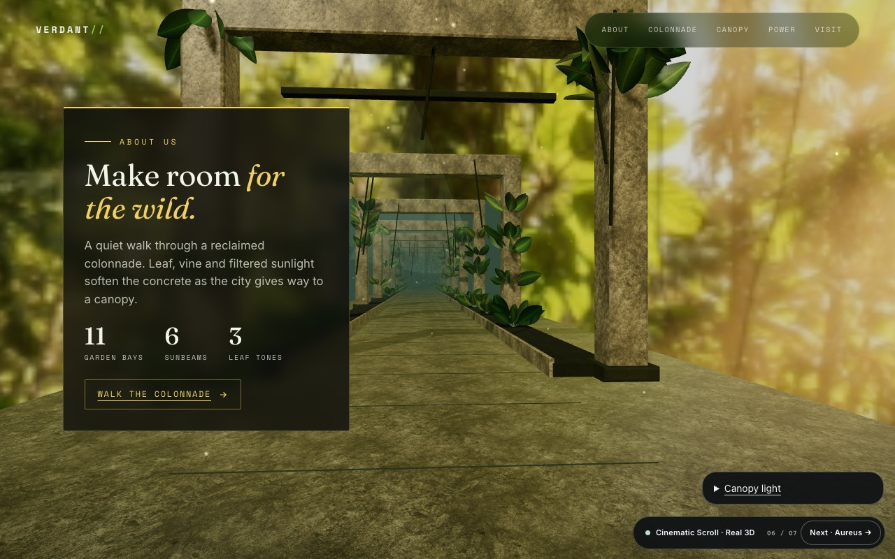

# Web Design Studio

### Three free agent skills for websites people remember: build it, prove it, make it convert.

[](https://www.npmjs.com/package/cinematic-scroll-skill)
[](https://github.com/MustBeSimo/web-design-studio/actions/workflows/ci.yml)
[](./LICENSE)
[](https://github.com/MustBeSimo/web-design-studio/stargazers)

<a href="https://mustbesimo.github.io/web-design-studio/"></a>

| Skill | Ask your agent for | Folder |
|---|---|---|
| **`cinematic-scroll`** | A distinctive scroll-driven, 3D or motion website in *your* brand, with the mobile, reduced-motion and no-JavaScript states built and checked. | [`skills/cinematic-scroll`](./skills/cinematic-scroll/SKILL.md) |
| **`scroll-audit`** | A scored review of any page's scroll experience (pacing, performance, accessibility, emotional arc) and a remediation plan. | [`skills/scroll-audit`](./skills/scroll-audit/SKILL.md) |
| **`launch-page-strategy`** | What a launch or landing page must say and prove before any design or motion: one action, objections answered, proof beside each claim. | [`skills/launch-page-strategy`](./skills/launch-page-strategy/SKILL.md) |

Formerly **Cinematic Scroll**; the `cinematic-scroll` identifier, npm package and ClawHub listing are unchanged.

## Install

```bash
npx skills add MustBeSimo/web-design-studio
```

Pick one skill or all three. The command works with Claude Code, Cursor, Codex, Hermes, Kimi Code, Gemini CLI, OpenClaw and the other agents the [skills CLI](https://github.com/vercel-labs/skills#supported-agents) supports (it needs Node 22 or newer; the npm installer below runs on Node 18). Each skill is a text-only folder, under 100 KB for all three, with no account, key or paid service required.

Then ask:

> Use cinematic-scroll to turn this product into a one-page story. Match the brand and assets in this project, create one memorable scroll reveal, and prove the mobile and reduced-motion versions.

> Use scroll-audit on https://your-site.example and write the remediation plan, highest-impact fix first.

> Use launch-page-strategy to write the story brief for our waitlist page before we design anything.

More prompts: [`examples/PROMPTS.md`](./examples/PROMPTS.md). Other agents and routes: [INTEGRATIONS.md](./INTEGRATIONS.md).

## See it

Everything below was built with the skill and is served from this repository.

**[Explore the live collection →](https://mustbesimo.github.io/web-design-studio/)** · **[Watch the 46-second film →](https://github.com/MustBeSimo/web-design-studio/releases/download/media-2026-10/promo-linkedin__web-design-studio-linkedin.mp4)**

### Seven real-time 3D flagships

Seven live websites, seven different reasons to use depth. Every flagship is scrollable, source-visible, bounded by a performance budget, and backed by a designed fallback.

| | |
|---|---|
| [](https://mustbesimo.github.io/web-design-studio/examples/aureus-flythrough/) **[01 · Aureus](https://mustbesimo.github.io/web-design-studio/examples/aureus-flythrough/)**<br><sub>Liquid chrome · camera descent</sub> | [](https://mustbesimo.github.io/web-design-studio/examples/gallery-flythrough/) **[02 · Atelier Marne](https://mustbesimo.github.io/web-design-studio/examples/gallery-flythrough/)**<br><sub>Art halls · architectural flythrough</sub> |
| [](https://mustbesimo.github.io/web-design-studio/examples/jungle-flythrough/) **[03 · Verdant](https://mustbesimo.github.io/web-design-studio/examples/jungle-flythrough/)**<br><sub>Instanced foliage · sunlight</sub> | [](https://mustbesimo.github.io/web-design-studio/examples/flagship/) **[04 · Aether](https://mustbesimo.github.io/web-design-studio/examples/flagship/)**<br><sub>Object · world · field · figure</sub> |
| [](https://mustbesimo.github.io/web-design-studio/examples/crystalline-monolith/) **[05 · Obsidian](https://mustbesimo.github.io/web-design-studio/examples/crystalline-monolith/)**<br><sub>Faceted glass · material response</sub> | [](https://mustbesimo.github.io/web-design-studio/examples/volumetric-aether/) **[06 · Weather](https://mustbesimo.github.io/web-design-studio/examples/volumetric-aether/)**<br><sub>Cloud volume · density control</sub> |
| [](https://mustbesimo.github.io/web-design-studio/examples/immersive/) **[07 · Nexus](https://mustbesimo.github.io/web-design-studio/examples/immersive/)**<br><sub>Particles · wave displacement</sub> | **[Explore all 28 examples →](https://mustbesimo.github.io/web-design-studio/)**<br><br>Try a live scene, then copy its build prompt and adapt it to your subject. |

<details>
<summary><strong>All 28 examples: more than one aesthetic</strong></summary>

The motion grammar stays consistent; the art direction does not. Browse the [complete visual collection](https://mustbesimo.github.io/web-design-studio/#worlds), including every original editorial and all eleven visual systems.

| Live example | Direction | Code |
|---|---|---|
| [Classic Touch](https://mustbesimo.github.io/web-design-studio/examples/renaissance/) | Renaissance editorial | [Source](./examples/renaissance/) |
| [Maya Torres](https://mustbesimo.github.io/web-design-studio/examples/studio/) | Brutalist creative studio | [Source](./examples/studio/) |
| [Vantascope](https://mustbesimo.github.io/web-design-studio/examples/noir/) | Editorial sci-fi | [Source](./examples/noir/) |
| [Maison Solenne](https://mustbesimo.github.io/web-design-studio/examples/luxe/) | Quiet luxury | [Source](./examples/luxe/) |
| [Bloom](https://mustbesimo.github.io/web-design-studio/examples/pop/) | Playful product story | [Source](./examples/pop/) |
| [Atelier Nocturne](https://mustbesimo.github.io/web-design-studio/examples/atelier/) | Kinetic editorial | [Source](./examples/atelier/) |
| [Digital Wealth](https://mustbesimo.github.io/web-design-studio/examples/digital-wealth/) | Financial product story | [Source](./examples/digital-wealth/) |
| [Kern](https://mustbesimo.github.io/web-design-studio/examples/kern-calibration/) | Mechanical instrument and calibration | [Source](./examples/kern-calibration/) |
| [Meridian](https://mustbesimo.github.io/web-design-studio/examples/symmetric-monument/) | symmetric monument | [Source](./examples/symmetric-monument/) |
| [Vanta Labs](https://mustbesimo.github.io/web-design-studio/examples/clinical-noir/) | clinical noir | [Source](./examples/clinical-noir/) |
| [Polly & Plot](https://mustbesimo.github.io/web-design-studio/examples/storybook-geometry/) | storybook geometry | [Source](./examples/storybook-geometry/) |
| [Obsidian](https://mustbesimo.github.io/web-design-studio/examples/temporal-monument/) | temporal monument | [Source](./examples/temporal-monument/) |
| [Farsight](https://mustbesimo.github.io/web-design-studio/examples/atmospheric-sublime/) | atmospheric sublime | [Source](./examples/atmospheric-sublime/) |
| [Keepsake](https://mustbesimo.github.io/web-design-studio/examples/warm-scrapbook/) | warm scrapbook | [Source](./examples/warm-scrapbook/) |
| [Drift](https://mustbesimo.github.io/web-design-studio/examples/naturalistic-drift/) | naturalistic drift | [Source](./examples/naturalistic-drift/) |
| [Concrete / Orange](https://mustbesimo.github.io/web-design-studio/examples/brutalist-kinetic/) | brutalist kinetic | [Source](./examples/brutalist-kinetic/) |
| [Chroma](https://mustbesimo.github.io/web-design-studio/examples/liquid-chrome/) | liquid chrome | [Source](./examples/liquid-chrome/) |
| [Verdant Press](https://mustbesimo.github.io/web-design-studio/examples/botanical-editorial/) | botanical editorial | [Source](./examples/botanical-editorial/) |
| [Signal](https://mustbesimo.github.io/web-design-studio/examples/data-cinematic/) | data cinematic | [Source](./examples/data-cinematic/) |
| [Naturally Rooted](https://mustbesimo.github.io/web-design-studio/examples/wellness/) | A slower editorial study | [Source](./examples/wellness/) |
| [Novadeck](https://mustbesimo.github.io/web-design-studio/examples/retro/) | A playful digital throwback | [Source](./examples/retro/) |

The visual systems live in [`themes/`](./themes/). The components live in [`components/`](./components/). They are starting points, not a fixed house style.

</details>

If an example helps you build something, [star the repository](https://github.com/MustBeSimo/web-design-studio) to keep it handy.

## Why a skill and not a prompt

A skill packages the working standard so you reuse it instead of re-explaining it on every project. Your brand determines the look; the skill gives the agent a process to build and inspect it.

| What you want | What the skill adds |
| --- | --- |
| A website that belongs to your brand | Brand precedence, visual references and a content-led story before effects. |
| Motion that explains the subject | Start → transformation → readable hold → exit, with reusable interaction patterns. |
| A page that remains usable | Explicit mobile, reduced-motion, no-JS and renderer-failure requirements. |
| Evidence you can inspect | Static checks and a five-profile browser proof workflow, with failures and missing evidence reported. |

The honest part: a three-build comparison on one brief (plain prompt, expert prompt, skill, same model) found no correctness advantage for the skill. The skill buys consistency and verification, not magic. Read [what was measured and what was not](docs/skill-advantage/README.md).

## Other install routes

All routes install the same text-only skill folders.

```bash
# only one skill, or a specific agent
npx skills add MustBeSimo/web-design-studio --skill scroll-audit
npx skills add MustBeSimo/web-design-studio --agent cursor

# OpenClaw / ClawHub (cinematic-scroll)
openclaw skills install cinematic-scroll

# npm installer, no dependencies
npx cinematic-scroll-skill
npx cinematic-scroll-skill --skill cinematic-scroll --dir .cursor/skills
```

Claude Code marketplace:

```text
/plugin marketplace add MustBeSimo/web-design-studio
/plugin install cinematic-scroll@mustbesimo
```

Since 3.0.0 the repository root has no skill file, so cloning the whole repository into a skills directory gives you the toolkit below, not a skill. See [COMPATIBILITY.md](./COMPATIBILITY.md) for per-agent notes.

## The toolkit in this repository

The skills are small on purpose. The rest of the repository is the craft around them:

- **Interaction toolkit.** Six text treatments, magnetic and depth surfaces, four original shader families and a shared scroll, pointer and proximity runtime, all MIT. React and Three.js adapters add demand rendering, adaptive quality, asset cleanup and context recovery. Start with [FIELD](./examples/v3-flagship/index.html), the [effects lab](./examples/effects-lab/index.html) and the [runtime guide](./references/interaction-runtime.md).
- **Design system.** A DTCG token contract ([`design.md`](./design.md) and [`tokens/`](./tokens/)), eleven one-file visual systems in [`themes/`](./themes/) and nine named components in [`components/`](./components/).
- **Verification.** `cinematic-doctor` scores static craft and exits non-zero below the threshold; the verifier adds browser evidence across desktop, mobile, reduced motion and no-JavaScript profiles.
- **Templates and 3D.** An optional [Next.js starter](./templates/nextjs/) for full release sites and [`ASSETS-3D.md`](./ASSETS-3D.md) for GLB/USDZ hand-off. Generated media through fal.ai is optional; demo mode and local assets work without a key.
- **Benchmark.** [CinematicBench](https://mustbesimo.github.io/web-design-studio/bench/) is the companion passive benchmark for pacing, performance, accessibility and motion craft.

```bash
npm run doctor -- examples/flagship/index.html                # static quality gate
node tools/verify/verify-build.mjs ./index.html --phase polish  # contract checks + browser evidence
node tools/page-proof/matrix.mjs ./index.html --out .verify/page-proof   # desktop, mobile, reduced motion, no-JS
```

A requested check that cannot run reports `INCOMPLETE`; a failed check reports `FAIL`. Neither is dressed up as success. Install browser-tool dependencies once with `npm install`; Chrome or Chromium is needed only for screenshot proof.

```text
skills/                    the three installable skills (text only)
design.md + tokens/        DTCG color, type, spacing, and motion contract
themes/                    eleven one-file visual systems
components/                nine named patterns in HTML and React
references/                toolkit guidance: story, build, motion, performance, 3D, XR
examples/                  28 live references, prompts, and real-time 3D flagships
templates/nextjs/          optional full-site starter
tools/                     doctor, verifier, page-proof, media archive, skill validators
evals/ and bench/          triggering checks, workflow evals, passive benchmark
```

Three/types are pinned to 0.185.0 because the compatible postprocessing release excludes 0.186. Optional runtime code belongs to your output; there is no hosted service dependency or paid visual-effect tier.

## Validation

On 12 September 2026, source v2.7.6 passed **6 reference fixtures** and **9 verifier failure-path tests**; FIELD returned clean reports in **5 browser profiles**. [Test scope and reproduction commands](docs/skill-advantage/README.md#verification-actually-run). The 3.0.0 release changes distribution, not the skill's build rules; the public comparisons that shaped those rules keep their builds, costs, screenshots and failures: [first comparison](bench/skill-ab/REVEAL.md) · [second run](bench/skill-ab/run2-hard/RESULTS-RUN2.md) · [latest sealed forward protocol](bench/skill-ab/v4-forward/README.md).

## Web Design Studio and Pro

The normal edition is the complete, useful product, not a trial.

| Web Design Studio · free forever | Web Design Studio Pro · for repeat practice |
|---|---|
| Three skills: build, audit, strategy | Build on accumulated project knowledge |
| Story and motion planning | Intent-based pattern retrieval |
| 28 references + 11 visual systems | Reuse tracking across builds |
| Components and real-time 3D patterns | Learned variants from your own language |
| Doctor + five-profile browser proof | Deeper iteration without starting cold |
| Optional TasteHQ matching | Proprietary Motif Engine |

### Make every project a head start.

Web Design Studio Pro adds the **Motif Engine**: retrieve patterns by intent, build on accumulated project knowledge, and develop variants from your own visual language. Bring what you learned into the next brief.

<p>
  <a href="https://buy.stripe.com/cNi7sLdNBbief0L0uFfnO09"></a>
</p>

[Compare editions](./references/editions.md) · [See how the stack fits](https://mustbesimo.github.io/web-design-studio/stack/)

<sub>The free edition remains available for unlimited personal and commercial projects.</sub>

## Develop and verify this repo

Follow [the release guide](docs/releasing.md) for version updates, trusted npm publishing and the separate ClawHub release.

```bash
npm install
npm test
```

The test suite checks tokens, themes, links, skill folders, the pointer stubs, components, the doctor, evals, benchmark behavior, verification semantics, browser-matrix orchestration, the npm payload, the media size gate and the TasteHQ adapter.

```bash
npm run skills:check          # every skills/* folder: text-only, self-contained, version-synced
npm run media:check           # no tracked file over 5 MB
npm run tokens:check
npm run themes:check
npm run proof -- examples/noir/index.html
npm run bench -- https://example.com
```

Promo media lives in the [`media-2026-10` release](https://github.com/MustBeSimo/web-design-studio/releases/tag/media-2026-10), not in the tree; `node tools/media-archive.mjs --plan` shows what would move.

## Principles

- Content and brand lead; effects follow.
- Use real 3D only when spatial depth carries meaning.
- One scroll clock, reversible setup, and no global teardown.
- Mobile is a composition, not a shrunken desktop.
- Reduced motion restores readable flow; it does not merely set duration to zero.
- A static poster or readable page is a designed state, not an apology.
- References inform direction without copying assets, logos, text, or exact compositions.

## License

MIT © 2026 [Simone Leonelli](https://w230.net). See [LICENSE](./LICENSE).

Built something with it? [Submit it to the showcase](https://github.com/MustBeSimo/web-design-studio/issues/new?title=Showcase:%20) or email [simone@w230.net](mailto:simone@w230.net).
